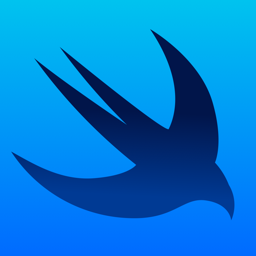

<div align="center">

  

# Kotlin KMP + SwiftUI Agent Skills

**Kombinovaný, open-source skill set pro AI coding agenty na mobilních appkách Kotlin Multiplatform (Android + iOS/SwiftUI).**

[](LICENSES/LICENSE-kotlin-kmp-agent-skills-Apache-2.0.txt)
[](LICENSES/LICENSE-swiftui-agent-skill-MIT.txt)
[](#obsah-skillů)
[](https://kotlinlang.org/docs/multiplatform/multiplatform-discover-project.html)
[](https://kotlinlang.org/docs/multiplatform/compose-multiplatform.html)
[](https://developer.apple.com/documentation/swiftui/)

Postavené pro [Claude Code](https://claude.ai) a kompatibilní AI agenty · formát [Agent Skills](https://agentskills.io)

</div>

---

## O projektu

Tento balíček spojuje dva samostatné open-source zdroje skillů do jednoho funkčního celku pro vývoj mobilní appky (Android + iOS) v **Kotlin Multiplatform**:

| Zdroj | Licence | Co přináší |
|---|---|---|
| [`kotlin-kmp-claude-agent-skills`](https://github.com/mmiani/kotlin-kmp-claude-agent-skills) (Mariano Miani) | Apache-2.0 | 15 skillů pro KMP/Compose Multiplatform: architektura, state management, data layer, navigace, testování, Gradle governance, platformní mosty (`expect`/`actual`), deep linky, bugfix a refactor-safety |
| [`SwiftUI-Agent-Skill`](https://github.com/AvdLee/SwiftUI-Agent-Skill) (Antoine van der Lee & Omar Elsayed) | MIT | 1 rozsáhlý skill pro nativní SwiftUI (iOS/macOS): state management, view composition, performance, animace, Instruments trace analýza |

Oba zdroje jsou zkopírované **beze změny** (jsou zdrojem pravdy) do [`skills/`](skills/). Nově přidaný je [`skills/kotlin-platform-swift-interop/`](skills/kotlin-platform-swift-interop/SKILL.md) — doplňuje jedinou věc, kterou žádný z obou zdrojů nepokrývá: **rozhraní mezi zkompilovaným Kotlin/Native frameworkem a nativním SwiftUI kódem, který ho konzumuje.** Je napsaný a ověřený proti aktuální dokumentaci na [kotlinlang.org](https://kotlinlang.org/) a odkazuje na [commonmain.dev](https://commonmain.dev/) jako kurátorovaný index KMP zdrojů.

## Obsah skillů

17 skillů, 5 kategorií. Každý skill je `SKILL.md`, jehož frontmatter zůstává v portabilním poli [Agent Skills](https://agentskills.io) — načte se beze změny v Claude Code, na claude.ai i přes Skills API.

### 🏗️ Architektura & implementace

| Skill | Co dělá |
|---|---|
| [`kotlin-project-architecture-review`](skills/kotlin-project-architecture-review/SKILL.md) | Review KMP architektury, PR a hranic vrstev. Vrací verdikt, seznam problémů a konkrétní doporučení. |
| [`kotlin-kmp-code-review`](skills/kotlin-kmp-code-review/SKILL.md) | Review implementovaného KMP/Compose kódu — umístění business logiky, korektnost state, concurrency, kvalita Compose, bezpečnost, odolnost. |
| [`kotlin-project-feature-implementation`](skills/kotlin-project-feature-implementation/SKILL.md) | Vede implementaci feature: checklist před psaním kódu, pravidla po vrstvách, návrh state pipeline. |
| [`kotlin-project-modularization`](skills/kotlin-project-modularization/SKILL.md) | Review/návrh hranic modulů, směru závislostí, viditelnosti a granularity. |
| [`kotlin-project-state-management`](skills/kotlin-project-state-management/SKILL.md) | Volba vzoru state-holderu napříč KMP targety — ViewModel, sdílený presenter, MVI, modelování `UiState`. |

### 🎨 UI & navigace

| Skill | Co dělá |
|---|---|
| [`kotlin-ui-compose-multiplatform`](skills/kotlin-ui-compose-multiplatform/SKILL.md) | Review sdíleného Compose UI — state-driven architektura, dekompozice composables, layout/modifier disciplína. |
| [`kotlin-ui-adaptive-resources`](skills/kotlin-ui-adaptive-resources/SKILL.md) | Review adaptivní UI strategie — window-size classes, canonical layouty, adaptace navigace, multi-window. |
| [`kotlin-navigation-compose-multiplatform`](skills/kotlin-navigation-compose-multiplatform/SKILL.md) | Review Compose Multiplatform navigace — modelování route, vlastnictví back stacku, NavOptions, deep linky. |
| [`swiftui-expert-skill`](skills/swiftui-expert-skill/SKILL.md) | Psaní, review i refaktoring nativního SwiftUI (iOS/macOS) — `@Observable` data flow, layout, performance, animace, Liquid Glass, Instruments trace analýza, migrace API. |

### 🔌 Platformní hranice

| Skill | Co dělá |
|---|---|
| [`kotlin-platform-swift-interop`](skills/kotlin-platform-swift-interop/SKILL.md) 🆕 | Vstupní bod a routovací tabulka pro cross-platform úkoly. Řeší hranici Kotlin/Native ↔ Swift: `suspend`/`Flow`/`@Throws`, vlákna, mapování sealed class, balení frameworku. |
| [`kotlin-platform-kmp-bridges`](skills/kotlin-platform-kmp-bridges/SKILL.md) | Review platformně-specifických integrací — umístění source-setů, hierarchické sdílení, `expect`/`actual`, entry pointy. |
| [`kotlin-platform-app-links-and-deep-links`](skills/kotlin-platform-app-links-and-deep-links/SKILL.md) | Review Android App Links a deep linků — intent-filtery, host verifikace, `assetlinks.json`. |

### 🗄️ Data, testování & build

| Skill | Co dělá |
|---|---|
| [`kotlin-data-kmp-data-layer`](skills/kotlin-data-kmp-data-layer/SKILL.md) | Review KMP datových vrstev — repozitáře, data sources, source-of-truth, řešení konfliktů, error handling. |
| [`kotlin-testing-kmp`](skills/kotlin-testing-kmp/SKILL.md) | Review testovací strategie — `kotlin.test`, unit testy, instrumentované testy, Compose UI testy, test doubles, screenshot testy. |
| [`kotlin-build-kmp-gradle-governance`](skills/kotlin-build-kmp-gradle-governance/SKILL.md) | Review struktury Gradle buildu — sdílená build logika, convention pluginy, version katalogy. |

### 🐛 Bugfix & refactoring

| Skill | Co dělá |
|---|---|
| [`kotlin-project-bugfix`](skills/kotlin-project-bugfix/SKILL.md) | Vede root-cause analýzu, minimální fix strategii a prevenci regresí u KMP bugů. |
| [`kotlin-kmp-refactor-safety`](skills/kotlin-kmp-refactor-safety/SKILL.md) | Review bezpečnosti refaktoringu — zachování chování, pokrytí testy, migrační strategie, rollback plány. |

---

## Jak to funguje dohromady

[`kotlin-platform-swift-interop`](skills/kotlin-platform-swift-interop/SKILL.md) je vstupní bod pro jakýkoli úkol, který se týká obou platforem najednou. Rozpozná, jestli projekt používá:

- **A) Compose Multiplatform sdílené UI** — Kotlin kreslí UI na Androidu i iOS, SwiftUI se použije jen pro tenký nativní host. Většina práce jde do `kotlin-ui-*` skillů.
- **B) Sdílená logika + nativní UI per platforma** — Jetpack Compose na Androidu, SwiftUI na iOS, obě strany konzumují stejný Kotlin shared modul. Používají se oba skill sety plně a propojovací skill řeší hranici mezi nimi (`suspend fn` → completion handler/async, `Flow` bez nativního Swift ekvivalentu, `@Throws`/`NSError`, vlákna, sealed class mapping, balení frameworku přes Xcode/CocoaPods/SPM).

Skill obsahuje routovací tabulku, která řekne, který ze 17 skillů načíst pro konkrétní úkol (feature přes obě platformy, review, bugfix, refactor, build), a kombinovaný correctness checklist pro samotnou hranici Swift ↔ Kotlin — ten doplňuje, nenahrazuje, checklisty obou zdrojových skillů.

## Struktura

```
kotlin-kmp-swiftui-skills/
  skills/
    kotlin-build-kmp-gradle-governance/
    kotlin-data-kmp-data-layer/
    kotlin-kmp-code-review/
    kotlin-kmp-refactor-safety/
    kotlin-navigation-compose-multiplatform/
    kotlin-platform-app-links-and-deep-links/
    kotlin-platform-kmp-bridges/
    kotlin-platform-swift-interop/      <- nový propojovací skill
    kotlin-project-architecture-review/
    kotlin-project-bugfix/
    kotlin-project-feature-implementation/
    kotlin-project-modularization/
    kotlin-project-state-management/
    kotlin-testing-kmp/
    kotlin-ui-adaptive-resources/
    kotlin-ui-compose-multiplatform/
    swiftui-expert-skill/
  LICENSES/
    LICENSE-kotlin-kmp-agent-skills-Apache-2.0.txt
    LICENSE-swiftui-agent-skill-MIT.txt
```

## Instalace do Claude Code

Zkopíruj obsah `skills/` do `.claude/skills/` v KMP projektu:

```powershell
Copy-Item -Path ".\kotlin-kmp-swiftui-skills\skills\*" -Destination "<cesta-k-projektu>\.claude\skills\" -Recurse -Force
```

Nebo vyber jen podmnožinu (např. jen `kotlin-platform-swift-interop` + `swiftui-expert-skill`, pokud KMP skilly instaluješ zvlášť přes `npx kotlin-kmp-agent-skills`).

> Orchestrační balíček (agenti `planner`/`implementer`/`reviewer`/`validator`/`fixer`, hooky, GitHub Actions) z `kotlin-kmp-claude-agent-skills` **není** součástí tohoto balíčku — záměrně, protože je to samostatný ticket-execution pipeline, ne znalostní skill.

## Licence a atribuce

Projekt je **open source** a kombinuje dva samostatně licencované zdroje — žádná část není k dispozici "pod oběma licencemi najednou", platí vždy licence konkrétního zdroje:

- `skills/kotlin-*` a `skills/kotlin-platform-swift-interop` (nový): **Apache-2.0**, viz [`LICENSES/LICENSE-kotlin-kmp-agent-skills-Apache-2.0.txt`](LICENSES/LICENSE-kotlin-kmp-agent-skills-Apache-2.0.txt). Nový skill vychází z obsahu a stylu `kotlin-kmp-claude-agent-skills` (Mariano Miani) a je distribuovaný pod stejnou licencí.
- `skills/swiftui-expert-skill`: **MIT**, viz [`LICENSES/LICENSE-swiftui-agent-skill-MIT.txt`](LICENSES/LICENSE-swiftui-agent-skill-MIT.txt). Autoři: Antoine van der Lee a Omar Elsayed.

Při dalším užití respektuj licenci té části, kterou používáš/upravuješ.

## Co ještě zkontrolovat před produkčním použitím

[`kotlin-platform-swift-interop/reference/swift-interop.md`](skills/kotlin-platform-swift-interop/reference/swift-interop.md) obsahuje sekci "Verifying this reference against current Kotlin releases" — Kotlin/Swift interop (completion handlery vs. nativní `async`, nástroje pro export do Swiftu) se vyvíjí mezi verzemi. Před spoléháním na konkrétní tvrzení v produkčním rozhodnutí ověř proti aktuální verzi Kotlinu v projektu.

---

<div align="center">

Apache-2.0 / MIT · Vytvořeno pro [Claude Code](https://claude.ai) a kompatibilní AI coding agenty

</div>
